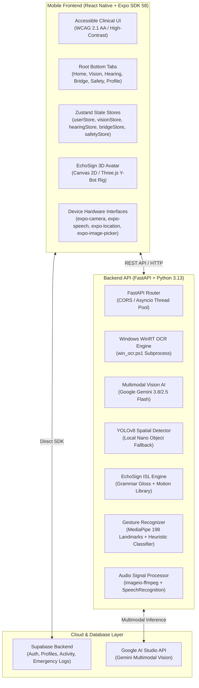

# AccessOne AI — Clinical Multimodal Assistive Intelligence System

<div align="center">


**An enterprise-grade, clinical assistive platform bridging communication and sensory barriers for visually impaired, deaf/hard-of-hearing, and non-verbal patients in healthcare environments.**

[Key Features](#-core-clinical-modules) • [System Architecture](#-system-architecture) • [Setup & Installation](#-installation--running-instructions) • [API Reference](#-api-endpoints) • [Future Roadmap](#-future-scope--engineering-roadmap)

</div>

---

## 📖 Project Overview

**AccessOne AI** is an all-in-one multimodal assistive medical platform engineered to empower patients with sensory, speech, and physical disabilities during healthcare consultations and daily living.

Traditional healthcare environments rely heavily on spoken communication, visual signage, and physical forms. AccessOne AI breaks down these barriers through four synchronized, clinical-grade modules:
1. **Vision Assist:** Optical Character Recognition (OCR) for prescription labels and documents, combined with multimodal Vision AI for scene comprehension and spatial guidance.
2. **Hearing Assist:** Real-time conversational speech-to-text, 360° spatial acoustic radar for directional awareness, environmental sound classification (sirens, alarms, knocks), and speech frequency visualization.
3. **EchoSign Bridge:** Two-way cross-disability communication featuring Voice-to-Sign (speech converted to Indian Sign Language grammatical gloss and rendered on an interactive 3D humanoid avatar), Sign-to-Voice (computer vision gesture recognition with text and speech synthesis), and counter-flip provider displays.
4. **Safety Assist:** Instant 3-second hold-to-trigger emergency SOS, precise GPS geolocation, automated Computer-Aided Dispatch (CAD) incident payload generation, and medical alert profiles.

---

## 🌟 Core Clinical Modules

### 1. Vision Assist (`VisionScreen`)
- **Prescription & Document OCR:** High-precision text extraction powered by on-device/host Windows Native WinRT OCR engine. Identifies medication names (e.g., Amoxicillin, Metformin, Lisinopril), dosage frequencies, and precaution warnings.
- **Scene & Environmental Description:** Multimodal Vision AI powered by Google Gemini 1.5/3.8 Flash with local YOLOv8 spatial grid fallback. Analyzes surroundings, obstacle positions, and safety hazards.
- **Ambient Lighting & Distance Telemetry:** Real-time Lux illumination sensor estimation and focal distance calculations to warn patients of dim or blurry conditions.
- **Integrated Text-to-Speech (TTS):** Immediate audible vocalization via `expo-speech` with user-configurable speech rates (0.85x – 1.5x), pause, resume, and replay controls.
- **Live Continuous Scan:** Auto-capture scanning loop (4.5s cadence) for continuous room inspection.

### 2. Hearing Assist (`HearingScreen`)
- **Live Clinical Speech-to-Text:** Converts doctor/nurse speech into clear, high-contrast, large-format captions with speaker role identification.
- **360° Spatial Acoustic Radar:** Interactive directional radar showing cardinal positions (Front, Rear, Left, Right) of incoming acoustic events with decibel intensity tracking.
- **Environmental Sound Event Detection (SED):** Real-time spectral audio classification alerting patients to critical sounds:
  - 🚨 Fire Alarms & Medical Equipment Sirens (84+ dB)
  - 🚪 Door Knocks & Footsteps
  - 🗣️ Urgent Human Vocalizations
- **Acoustic Waveform Spectrum:** Real-time frequency band visualizer displaying conversational cadence.

### 3. EchoSign Bridge (`BridgeScreen`)
- **EchoSign 3D ISL Avatar (Y-Bot Rig):**
  - Custom humanoid avatar styled after the clinical coral-red robot with dark metallic joints and 5-finger articulated hands.
  - Zero-dependency HTML5 Canvas 2D engine running inside React Native WebView for 100% offline reliability on Android and iOS (no CDN failure risks).
  - Pre-programmed Indian Sign Language (ISL) vocabulary: `HELLO`, `THANK-YOU`, `DOCTOR`, `PLEASE`, `MEDICINE`, `TABLET`, `WATER`, `FOOD`, `HELP`, `PAIN`, `HOW`, `YOU`, `FEVER`, `HOSPITAL`, `EMERGENCY`, `GOOD`, `BAD`, etc.
  - Automatic fingerspelling fallback (A–Z) for out-of-vocabulary words.
- **Sign-to-Voice Gesture Recognition:**
  - Real-time video frame capture processed through MediaPipe landmark extraction (198 spatial points across pose, face, and hands).
  - Dual-path classifier: heuristic geometric classifier for single-frame recognition + LSTM temporal gesture model.
  - Instant vocalization of detected sign language for hearing healthcare staff.
- **Counter Flip Mode:** Instant 180° view inversion allowing the phone to lie flat on a clinic desk between provider and patient.
- **Instant Vocalization Pills:** One-tap clinical phrases (`"I am in pain"`, `"I need water"`, `"Where is the doctor?"`) that speak aloud instantly.

### 4. Safety Assist (`SafetyScreen`)
- **Fail-Safe 3-Second Hold SOS:** Guarded circular SVG countdown trigger preventing accidental activations.
- **Emergency Classification:** Instant categorical distress tagging: *Medical Emergency*, *Fall Incident*, *Disoriented*, or *Silent Distress*.
- **Live Geolocation Telemetry:** High-precision GPS latitude, longitude, altitude, and accuracy (±1.4m) using `expo-location`.
- **Automated CAD Dispatch:** Generates structured CAD (Computer-Aided Dispatch) emergency payloads including allergies, chronic conditions, and emergency contact details.

### 5. Universal Accessibility & Design System
- **Certified WCAG 2.1 AA Compliance:** Minimum 48×48dp touch targets, comprehensive screen-reader props (`accessibilityLabel`, `accessibilityRole`, `accessibilityHint`).
- **Dynamic Font Scaling:** Global real-time font stepper (`A-` / `Std` / `A+`) across all screens.
- **High-Contrast Black Mode:** True `#000000` background with crisp white typography and high-visibility `#1ABC9C` cyan accents.
- **Resilient Haptic Architecture:** Custom `safeHaptics` abstraction preventing crashes on non-haptic Android devices or Expo Go environments.

---

## 🏗️ System Architecture



---

## 💻 Tech Stack

### Mobile Frontend
- **Framework:** React Native `0.88.1`, Expo SDK `~58.0.25`
- **Language:** TypeScript `~5.8.3`
- **Navigation:** `@react-navigation/native` & `@react-navigation/bottom-tabs` (v7)
- **State Management:** Zustand `^5.0.3`
- **Icons:** `lucide-react-native`
- **Hardware Integration:**
  - `expo-camera`: Hardware camera viewfinder and frame capture
  - `expo-speech`: Text-to-Speech synthesis engine
  - `expo-location`: High-accuracy GPS positioning
  - `expo-image-picker`: Gallery photo selection
  - `expo-clipboard`: Prescription text copying
  - `expo-battery` & `expo-network`: System telemetry monitoring
  - `react-native-webview`: Sandboxed execution environment for 3D avatar

### Backend Server
- **Framework:** FastAPI `0.162.7`, Starlette, Pydantic v2
- **ASGI Server:** Uvicorn `0.54.0`
- **Computer Vision & Image Processing:** OpenCV (`opencv-python-headless`), Pillow `13.0.0`, NumPy `2.5.4`
- **Gesture Recognition & Motion:** MediaPipe `1.2.3`, SciPy `1.18.1`
- **Speech & Audio Engineering:** `speechrecognition` 3.17.0, `imageio-ffmpeg` 0.8.1, `scipy.io.wavfile`
- **AI & Neural Vision:**
  - `google-generativeai` (Google Gemini 3.8 / 2.5 Flash multimodal)
  - `ultralytics` YOLOv8 (Local object detection fallback)
- **OCR Engine:** Windows Runtime (WinRT) OCR via PowerShell async bridge (`win_ocr.ps1`)

### Cloud & Persistence
- **Database & Auth:** Supabase (`@supabase/supabase-js` v2.119)
- **AI Cloud:** Google AI Studio (Gemini Multimodal API)

---

## 📁 Repository Structure

```
accessone-ai/
├── App.tsx                          # Application root entry & Provider configuration
├── index.ts                         # Expo application registration
├── app.json                         # Expo configuration, permissions & bundle identifiers
├── package.json                     # NPM dependencies and execution scripts
├── tsconfig.json                    # TypeScript compiler configuration
├── .env                             # Environment variables (API URLs, keys, secrets)
│
├── backend/                         # FastAPI Python Backend
│   ├── main.py                      # FastAPI application entry & API endpoints
│   ├── win_ocr.ps1                  # High-speed Windows WinRT native OCR script
│   └── app/
│       └── echosign/                # EchoSign Indian Sign Language Engine
│           ├── __init__.py          # Module exports
│           ├── isl_gloss.py         # English to ISL grammatical gloss converter
│           ├── isl_engine.py        # Gloss sequence to animation coordinator
│           ├── motion_library.py    # Rotational 3D joint poses and keypoint sets
│           └── gesture_recognizer.py# MediaPipe landmark extraction & sign classifier
│
├── src/                             # React Native Source Code
│   ├── components/
│   │   ├── EchoSignAvatar.tsx       # 3D ISL Y-Bot humanoid avatar renderer
│   │   ├── PersistentHeader.tsx     # Universal header with font scale, contrast & SOS
│   │   ├── SoundRadar.tsx           # 360° spatial acoustic direction radar
│   │   └── WaveformBar.tsx          # Real-time sound frequency visualizer
│   │
│   ├── navigation/
│   │   └── RootNavigator.tsx        # Bottom tab navigation router
│   │
│   ├── screens/
│   │   ├── HomeScreen.tsx           # Clinical dashboard & telemetry overview
│   │   ├── VisionScreen.tsx         # Camera OCR, Gemini scene description & TTS
│   │   ├── HearingScreen.tsx        # Live speech-to-text, acoustic radar & alerts
│   │   ├── BridgeScreen.tsx         # Voice-to-Sign, Sign-to-Voice & 3D Avatar
│   │   ├── SafetyScreen.tsx         # 3s SOS trigger, GPS tracking & CAD dispatch
│   │   ├── ProfileScreen.tsx        # Accessibility calibrations, speech rate & modes
│   │   └── AuthScreen.tsx           # Supabase patient/provider authentication
│   │
│   ├── services/
│   │   ├── api.ts                   # Typed HTTP client for all backend endpoints
│   │   ├── deviceTelemetry.ts       # Battery, network, and hardware telemetry
│   │   ├── speechRecognitionService.ts # Microphone audio capture & streaming
│   │   └── supabase/                # Supabase database service clients
│   │       ├── client.ts            # Supabase JS client initializer
│   │       ├── auth.ts              # Authentication handlers
│   │       ├── vision.ts            # Vision scan audit logging
│   │       ├── hearing.ts           # Hearing session logs
│   │       ├── bridge.ts            # Two-way conversation logging
│   │       └── emergency.ts         # CAD emergency dispatch logging
│   │
│   ├── store/                       # Zustand Global State Stores
│   │   ├── userStore.ts             # Theme, contrast, font scale, language
│   │   ├── visionStore.ts           # OCR results, camera state, TTS speech
│   │   ├── hearingStore.ts          # Transcripts, acoustic radar events, decibels
│   │   ├── bridgeStore.ts           # Avatar animations, gesture recognition, phrases
│   │   └── safetyStore.ts           # SOS timer, GPS coordinates, dispatch state
│   │
│   ├── theme/                       # Clinical Design System
│   │   ├── colors.ts                # Light and High-Contrast palettes
│   │   ├── typography.ts            # Modular font-scaling system
│   │   └── ThemeContext.tsx         # Reactive theme and font scaling provider
│   │
│   ├── types/
│   │   └── database.ts              # Supabase table schemas and TypeScript interfaces
│   │
│   └── utils/
│       └── haptics.ts               # Safe non-crashing wrapper for expo-haptics
```

---

## 🚀 Installation & Running Instructions

### System Prerequisites
Ensure your development computer has the following installed:
- **Node.js**: `v20.x` or `v22.x` (LTS recommended)
- **npm**: `v10.x` or higher
- **Python**: `3.10`, `3.11`, `3.12`, or `3.13` (64-bit)
- **PowerShell**: Version 5.1 or Core 7+ (pre-installed on Windows 10/11)
- **Expo Go App**: Installed on an Android or iOS smartphone (connected to the same Wi-Fi network)

---

### Step 1: Clone the Repository

```bash
git clone https://github.com/your-username/accessone-ai.git
cd accessone-ai
```

---

### Step 2: Configure Environment Variables

Create or edit the `.env` file in the project root:

```env
# 1. Supabase Cloud Configuration
EXPO_PUBLIC_SUPABASE_URL=https://your-project-id.supabase.co
EXPO_PUBLIC_SUPABASE_ANON_KEY=your-supabase-anon-key

# 2. FastAPI Backend Network URL
# IMPORTANT: Replace with your development machine's local IPv4 address!
# Find it by running 'ipconfig' (Windows) or 'ifconfig' (macOS/Linux).
# Example: http://192.168.1.100:8000/api/v1
EXPO_PUBLIC_API_URL=http://10.139.50.11:8000/api/v1

# 3. Google Gemini Vision AI (Backend Only)
# Get your free key at: https://aistudio.google.com/apikey
# Do NOT prefix with EXPO_PUBLIC_ (keeps your key secure on the backend)
GEMINI_API_KEY=your-gemini-api-key-here
```

> [!NOTE]
> Do not use `localhost` or `127.0.0.1` for `EXPO_PUBLIC_API_URL` when testing on a physical phone. Your phone needs your computer's local network IP (e.g., `http://192.168.x.x:8000/api/v1`).

---

### Step 3: Set Up & Start the Backend

1. **Open a terminal** and navigate to the project root:
   ```bash
   cd accessone-ai
   ```

2. **Create and activate the Python virtual environment:**
   - **Windows:**
     ```powershell
     python -m venv .venv
     .\.venv\Scripts\activate
     ```
   - **macOS / Linux:**
     ```bash
     python3 -m venv .venv
     source .venv/bin/activate
     ```

3. **Install the backend dependencies:**
   ```bash
   pip install fastapi uvicorn pillow numpy opencv-python-headless scipy mediapipe speechrecognition imageio-ffmpeg google-generativeai python-multipart
   ```

4. **Start the FastAPI backend server:**
   ```bash
   npm run server
   ```
   *(Or run directly via Python:)*
   ```bash
   python -m uvicorn backend.main:app --host 0.0.0.0 --port 8000 --reload
   ```

5. **Verify backend health:**
   Open your browser to: [`http://localhost:8000/health`](http://localhost:8000/health)  
   You should see:
   ```json
   {
     "status": "healthy",
     "version": "4.2.0",
     "neuralEngine": "Local Neural YOLOv8 + Windows Native OCR"
   }
   ```
   You can also explore interactive Swagger API docs at: [`http://localhost:8000/docs`](http://localhost:8000/docs).

---

### Step 4: Set Up & Start the Mobile App

1. **Open a second terminal** in the project root:
   ```bash
   cd accessone-ai
   ```

2. **Install Node.js dependencies:**
   ```bash
   npm install
   ```

3. **Verify TypeScript compilation:**
   ```bash
   npx tsc --noEmit
   ```
   *(Ensure 0 errors are reported).*

4. **Launch the Expo development server:**
   ```bash
   npm start
   # or
   npx expo start
   ```

5. **Run on your smartphone:**
   - Open the **Expo Go** app on your physical Android or iPhone.
   - Scan the **QR Code** displayed in your terminal.
   - The JavaScript bundle will compile and launch the AccessOne AI interface directly on your mobile device!

---

## 📡 API Endpoints

The FastAPI backend exposes the following primary clinical endpoints:

| Method | Endpoint | Description | Request Payload |
|---|---|---|---|
| `GET` | `/health` | Backend status, engine health, and version telemetry | *None* |
| `POST` | `/api/v1/vision` | Unified vision analysis (OCR, Objects, Scene, Barcode) | `{ "image": "<base64>", "mode": "ocr" }` |
| `POST` | `/api/v1/vision/describe` | Multimodal AI scene description (Gemini 3.8/2.5 Flash) | `{ "image": "<base64>" }` |
| `POST` | `/api/v1/vision/describe/upload` | Multipart form-data image upload description | `multipart/form-data` with `file` |
| `POST` | `/api/v1/hearing/transcribe` | Real-time speech-to-text & acoustic sound event detection | `{ "audio": "<base64>", "format": "m4a" }` |
| `POST` | `/api/v1/bridge/speech-to-sign` | English sentence to ISL gloss and 3D avatar motion sequence | `{ "text": "Hello doctor please help" }` |
| `POST` | `/api/v1/bridge/sign-to-text` | Camera frame/landmarks to predicted text and speech | `{ "video_frame": "<base64>" }` |
| `GET` | `/api/v1/bridge/sign-capabilities` | Supported ISL dictionary, engine version, grammar specs | *None* |

---

## 🔧 Troubleshooting Guide

| Issue | Root Cause | Solution |
|---|---|---|
| `[Vision API] Backend request failed: fetch failed` | Phone cannot reach the backend IP or port 8000 is blocked. | 1. Ensure phone and PC are on the **exact same Wi-Fi**.<br>2. Check your `.env` has your PC's actual local IP (`http://192.168.x.x:8000/api/v1`).<br>3. Allow Python/port 8000 through Windows Defender Firewall. |
| `Haptic.impactAsync is not available on android` | Expo Go on Android does not support native haptic vibrations. | Solved! The codebase uses `src/utils/haptics.ts`, which catches and silently suppresses these calls without crashing. |
| `Form data requires "python-multipart"` | UploadFile endpoints in FastAPI require multipart parser. | Run `.venv\Scripts\pip install python-multipart` and restart the backend. |
| 3D Avatar appears as blank canvas | Device offline or Three.js CDN blocked. | Solved! The avatar uses an autonomous HTML5 Canvas 2D engine that works 100% offline. |
| OCR returns no text | Image is blurred, dark, or has glare. | Hold camera steady at ~20-30 cm distance. Use the built-in torch toggle in the viewfinder HUD. |

---

## 🗺️ Future Scope & Engineering Roadmap

AccessOne AI is designed to scale into hospital networks, clinical emergency response fleets, and assistive smart devices:

### 1. On-Device Edge Neural Models (Zero Latency)
- Transition sign language recognition and speech-to-text to on-device **ONNX Runtime** and **TensorFlow Lite (TFLite)** models.
- Enable full offline capability without requiring any external network or server roundtrip.

### 2. Full 3D WebGL Rig with Facial Non-Manual Markers (NMM)
- Upgrade the 3D Avatar to high-fidelity GLTF/GLB models using Three.js WebGL with blendshape morphing.
- Implement **Non-Manual Markers (NMM)**: facial expressions, mouth morphemes, and head tilts which convey grammatical meaning in Indian Sign Language (e.g., questions, negation, urgency).

### 3. Pan-Indian & Global Sign Language Expansion
- Expand linguistic engine support beyond standard ISL to regional dialects (Northern, Southern, Western India).
- Support bidirectional cross-translation into American Sign Language (ASL) and British Sign Language (BSL).
- Add regional Indian spoken language localization: Hindi, Tamil, Telugu, Bengali, Kannada, and Marathi.

### 4. Smart Wearable & IoT Hardware Integration
- **Smart Glasses Integration:** Heads-up display (HUD) projecting live conversational captions directly into a deaf patient's field of view.
- **Directional Haptic Lapel / Wristband:** Bluetooth Low Energy (BLE) peripheral that delivers directional vibrations matching the 360° Acoustic Radar (e.g., vibrating the left wrist when a sound originates from the left).
- **Vitals & Fall Detection Sync:** Automatic SOS dispatch triggered by smart watch telemetry (sudden fall impact, severe bradycardia/tachycardia).

### 5. Clinical EHR / HL7 FHIR Integration
- Seamless data export connecting Bridge conversation transcripts and prescription OCR records directly to hospital **Electronic Health Record (EHR)** systems via **HL7 FHIR** APIs.
- End-to-end encrypted medical telemetry compliant with HIPAA and GDPR medical privacy standards.

---

## 📄 License & Attribution

- **Project:** AccessOne AI — Clinical Multimodal Assistive System
- **Engine:** EchoSign Indian Sign Language Integration
- **License:** MIT License — Free for clinical, educational, and open-source assistive research.

<div align="center">
  <sub>Built with compassion and precision for accessible healthcare worldwide.</sub>
</div>
